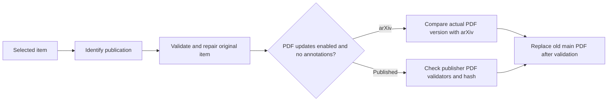

# Metadata Fixer


**English** | [简体中文](README.zh-CN.md)

Find published versions and repair metadata in the original Zotero item.

## Install and use

Requires Zotero 10. Download the XPI from [Releases](https://github.com/lzcn/zotero-metadata-fixer/releases/latest) and install it through **Tools → Plugins → Install Plugin From File**.

Select items, right-click and choose **Metadata Fixer**. The results window shows progress and status; hover over either for details, or click a row to select its item. Cancel or close the window to stop pending work.

The plugin finds published versions, fills missing DOIs and fields, repairs record types, standardizes proceedings titles and optionally updates PDFs. Updates preserve annotations, notes, collections, tags and relations; superseded unannotated main PDFs are moved to Trash after a successful replacement. Editing an item during retrieval stops its update; empty results preserve existing fields.

## Settings

- Choose original, standard or short proceedings titles.
- Show publication abbreviations in Zotero's native column. Disable Zotero Style's Publication Column to avoid conflicts.
- PDF updates are on by default: skip items with annotated PDFs; otherwise keep the latest version, preferring the published version over arXiv. Publisher access is required.
- Optionally add a [Semantic Scholar API key](https://www.semanticscholar.org/product/api#api-key-form), stored locally and sent only to `api.semanticscholar.org`.

Lookup uses Zotero translators and scholarly metadata services. Conflicting or unverified matches are skipped. Run updates manually; install plugin updates from XPI.

## Update flow

Identifiers and official publication links come first. Title searches expand from Crossref/OpenAlex to DBLP/OpenReview and then secondary sources only when needed. Reliable matches stop further searches; conflicting candidates stop automatic updates. Semantic Scholar remains optional. Requests share caching, pacing and cooldowns across batches; blocked sources are paused.



arXiv versions come from the attached PDF's first page or a hash-verified download cache, not the item's metadata. Unknown local versions are checked by downloading and comparing file hashes. Published PDF checks retain conditional requests and file deduplication. Annotated PDFs stop PDF updates without stopping metadata repairs. Validated newer PDFs replace old main files, including arXiv manuscripts when a formal publication is found. The original item ID and supplementary files are preserved.

The results window uses a fixed Bear-inspired palette with a compact table and system fonts. Colors follow the system’s light or dark appearance; Settings use Zotero’s native controls.

## Development

Use Node.js 22.13+ (22.x) or 24+.

```sh
npm ci
npm run check
npm run build
```

Output: `dist/zotero-metadata-fixer.xpi`. `npm run test:host` uses disposable Zotero directories. `npm run release` prepares local files under `release/v<version>/` without uploading.

## Acknowledgments

Thanks to [Federico Torrielli and contributors](https://github.com/federicotorrielli/zotero-metadata-hunter) (Metadata Hunter), [AllanChain and contributors](https://github.com/AllanChain/zotero-arxiv-workflow) (arXiv Workflow), [northword and contributors](https://github.com/northword/zotero-format-metadata) (Linter for Zotero), and the [Zotero translators contributors](https://github.com/zotero/translators).

## License

Copyright © 2026 Zhi Lu. [AGPL-3.0-or-later](LICENSE). Code developed with ChatGPT and DeepSeek.
