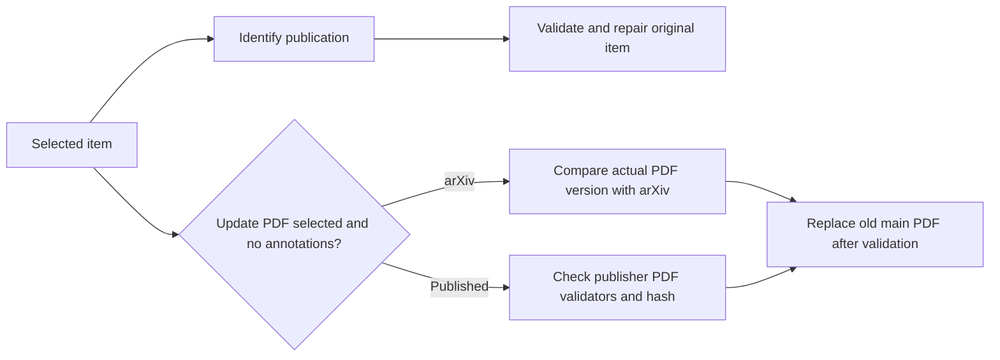

# Metadata Fixer


**English** | [简体中文](README.zh-CN.md)

Find published versions and repair metadata in the original Zotero item.

## Install and use

Requires Zotero 10. Download the XPI from [Releases](https://github.com/lzcn/zotero-metadata-fixer/releases/latest) and install it through **Tools → Plugins → Install Plugin From File**.

Select items and right-click **Complete Metadata**, **Repair Metadata**, or **Update PDF**. Each action has a native icon. The preferred action appears first (initially Complete Metadata); choose it in Settings. While an action runs, you can queue more items or another action for the same paper. Each item and action runs once per batch, in the order added. The results window shows the action and outcome for each row. Hover for details, or click a row to select its item. Cancel or close the window to stop pending work.

**Complete Metadata** only fills empty fields and an empty author list, preserving populated values and the item type. **Repair Metadata** includes filling and corrects retrieved bibliographic fields—including authors, date, venue, volume, issue, pages, publisher and identifiers—after confirming the same work. It also finds published versions, repairs record types and formats proceedings titles. Missing source values never erase existing fields. **Update PDF** only checks and updates the PDF. Repair Metadata and Complete Metadata never update PDFs. Updates preserve annotations, notes, collections, tags and relations. Superseded unannotated main PDFs are moved to Trash after a successful replacement. Editing an item during retrieval stops its update. Empty results preserve existing fields.

## Settings

- Choose the default action: Complete Metadata, Repair Metadata or Update PDF.
- Choose original, standard or short proceedings titles.
- Show publication abbreviations in Zotero's native column. Disable Zotero Style's Publication Column to avoid conflicts.

Update PDF skips items with annotated PDFs. Otherwise it keeps the latest version, preferring the published version over arXiv. Publisher access is required.

Lookup uses Zotero translators and scholarly metadata services. Conflicting or unverified matches are skipped. Run updates manually. Install plugin updates from XPI.

## Update flow

Existing formal DOIs are queried before title discovery. A matching DOI with a corroborating title or authors can repair incorrect metadata; capitalization and punctuation alone are preserved. Without that identifier confirmation, title matching remains required. Errors shared by the authoritative source cannot be corrected from that source alone.

Existing formal DOIs use Zotero translators, with DOI content negotiation and single-record Crossref/OpenAlex/DataCite enrichment as fallbacks. Without a formal DOI, lookup proceeds in this order:

1. Check the item's URL for a verified publication.
2. Use venue/year hints, including `Conference:` in Extra, to check official conference paper lists.
3. Follow repository publication links and check newly discovered conference hints.
4. Search Crossref/OpenAlex, then DBLP/OpenReview, then Semantic Scholar/PubMed, and finally Google Scholar or publisher search.

A verified match stops further discovery. An unavailable or unverified source falls through; a strong conflict stops automatic updates. Each hinted conference list is attempted once per lookup. Requests share caching, pacing and cooldowns across batches. Blocked sources are paused.

Candidate HTTP(S) pages and single-record BibTeX are retrieved with Zotero translators and checked against the item's title, authors, publication type, venue and publication status. BibTeX supplied by a verified index is used before requesting its page. This applies to conferences and journals without requiring their names or publisher domains in a catalog. OpenAlex publisher links and PubMed records are retained without a DOI. Conflicting or unverifiable matches leave the item unchanged. Missing DOIs and other unavailable fields stay blank.

Automatic publication upgrades require a completed identifier lookup, an accepted venue record, an official proceedings page or explicit publication evidence from an index. Citation tags or an author-provided BibTeX alone do not prove publication. Author checks compare given names or initials and corroborate multiple authors when both lists provide them. A shared surname alone cannot override conflicting given names. Evidence markers are temporary and are never saved to the library.

Conference-site integrations support NeurIPS (NIPS), ICML and ICLR. Hints locate records and do not prove acceptance. OpenReview submissions and main-conference/workshop identities are checked separately. Accepted OpenReview records are reused within the batch for forum verification and retrieval; contradictory event identities remain visible. Equivalent public records are tried when another source is inaccessible.



arXiv versions come from the attached PDF's first page or a hash-verified download cache, not the item's metadata. Unknown local versions are checked by downloading and comparing file hashes. Published PDF checks retain conditional requests and file deduplication. Annotated PDFs stop PDF updates without stopping metadata repairs. Validated newer PDFs replace old main files, including arXiv manuscripts when a formal publication is found. The original item ID and supplementary files are preserved.

The results window uses a fixed Bear-inspired palette with a compact table and system fonts. Colors follow the system’s light or dark appearance. Settings use Zotero’s native controls.

## Development

Use Node.js 22.13+ (22.x) or 24+.

```sh
npm ci
npm run check
npm run build
```

Output: `dist/zotero-metadata-fixer.xpi`. `npm run test:host` uses disposable Zotero directories. `npm run release` prepares local files under `release/v<version>/` without uploading.

## Acknowledgments

Thanks to [Federico Torrielli and contributors](https://github.com/federicotorrielli/zotero-metadata-hunter) (Metadata Hunter), [AllanChain and contributors](https://github.com/AllanChain/zotero-arxiv-workflow) (arXiv Workflow), [northword and contributors](https://github.com/northword/zotero-format-metadata) (Linter for Zotero), and the [Zotero translators contributors](https://github.com/zotero/translators).

## License

Copyright © 2026 Zhi Lu. [AGPL-3.0-or-later](LICENSE). Code developed with ChatGPT and DeepSeek.
