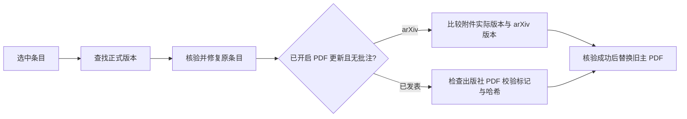

# Metadata Fixer


[English](README.md) | **简体中文**

查找正式发表版本，在原 Zotero 条目中修复元数据。

## 安装与使用

需要 Zotero 10。从 [Releases](https://github.com/lzcn/zotero-metadata-fixer/releases/latest) 下载 XPI，通过 **工具 → 插件 → 从文件安装插件** 安装。

选中条目，右键选择 **Metadata Fixer**。结果窗口分别显示元数据与 PDF 结果，鼠标悬停可查看详情，点击行可选中对应条目。取消或关闭窗口会停止未完成的工作。

插件可查找正式版本、补全 DOI 和字段、修正条目类型、统一论文集名称，并按设置更新 PDF。更新保留批注、笔记、集合、标签和关系。无批注的旧主 PDF 在成功替换后移入回收站。检索期间修改条目会停止其更新，空结果保留已有字段。

## 设置

- 论文集名称使用原名、标准全名或缩写。
- 在 Zotero 原生列显示出版物简称。请关闭 Zotero Style 的 Publication Column，避免冲突。
- PDF 更新默认开启：有批注则跳过，否则保留最新版，正式发表版优先于 arXiv 版。需要出版社访问权限。

检索使用 Zotero 翻译器及学术元数据服务，跳过冲突或未核验的结果。手动运行更新，通过 XPI 安装插件更新。

## 更新流程

优先使用标识符及正式发表页面。已有 DOI 交由 Zotero 翻译器处理，并以 DOI 内容协商和 Crossref/OpenAlex/DataCite 单条记录补充作为回退。只有在没有正式 DOI 时才做标题检索。标题检索从 Crossref/OpenAlex 开始，仅在需要时扩展到 DBLP/OpenReview 和后续来源。可靠匹配会停止继续搜索，候选冲突会停止自动更新。请求跨批次共享缓存、限流和冷却，访问受限时暂停该来源。

无 DOI 时先检查条目 URL，再按标题和作者检索学术索引。候选 HTTP(S) 页面和单条 BibTeX 交由 Zotero 翻译器读取，并核对标题、作者、出版类型、出版物和发表状态。会议、期刊名称及出版社域名无需预先列入目录。OpenAlex 出版页面和 PubMed 记录不会因缺少 DOI 被丢弃。冲突或无法核验的匹配不改写条目。未提供的 DOI 和其他字段留空。

自动转为正式版本需要已完成的标识符核验、接收记录、官方论文集页面或索引明确提供的发表证据。仅有引用字段或作者提供的 BibTeX 不证明已经发表。作者核验比较名字或首字母。双方提供多位作者时交叉核对共同作者，同姓不能掩盖名字冲突。证据标记仅供本次核验，不写入文献库。

会议网站集成提供额外的发现路径。NeurIPS（NIPS）、ICML 和 ICLR 线索可定位官方论文列表。OpenReview 投稿状态以及主会、workshop 身份分别核验。找到可靠匹配后停止检索，来源不可访问时尝试同一出版记录的公开来源。



arXiv 版本来自附件首页或经过哈希核验的下载缓存，不根据条目元数据猜测。无法识别本地版本时下载并比较文件哈希。正式版 PDF 保留条件请求和文件去重。有批注时只跳过 PDF 更新，元数据仍可修复。核验成功的新版会替换旧主 PDF，包括从 arXiv 转为正式发表版的情况。原条目 ID 和补充文件均会保留。

结果窗口以 Bear 配色为基础，采用固定样式、紧凑表格和系统字体。颜色跟随系统的浅色或深色外观。设置页使用 Zotero 原生控件。

## 开发

需要 Node.js 22.13+（22.x）或 24+。

```sh
npm ci
npm run check
npm run build
```

产物：`dist/zotero-metadata-fixer.xpi`。`npm run test:host` 使用临时 Zotero 目录。`npm run release` 在 `release/v<版本>/` 准备本地文件，不上传。

## 致谢

感谢 [Federico Torrielli 及贡献者](https://github.com/federicotorrielli/zotero-metadata-hunter)（Metadata Hunter）、[AllanChain 及贡献者](https://github.com/AllanChain/zotero-arxiv-workflow)（arXiv Workflow）、[northword 及贡献者](https://github.com/northword/zotero-format-metadata)（Linter for Zotero）以及 [Zotero 翻译器贡献者](https://github.com/zotero/translators)。

## 许可证

Copyright © 2026 Zhi Lu. [AGPL-3.0-or-later](LICENSE)。代码借助 ChatGPT 和 DeepSeek 开发。
